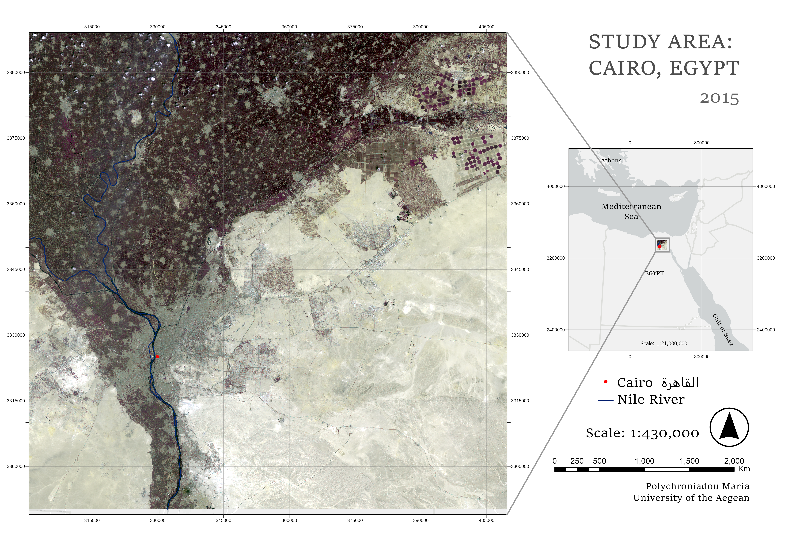
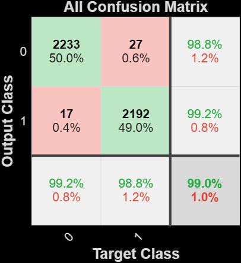
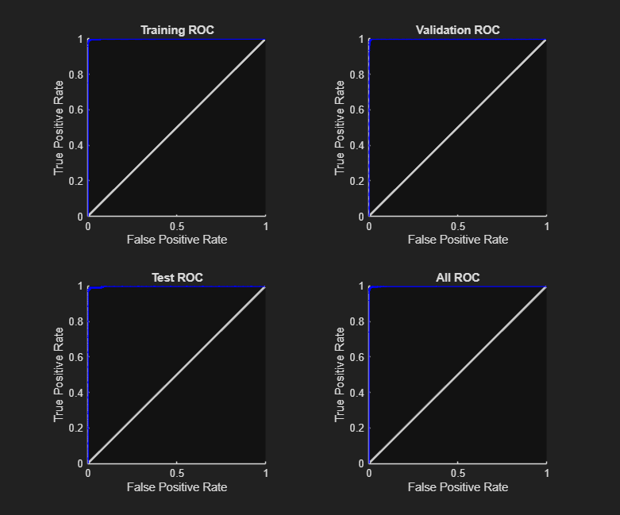
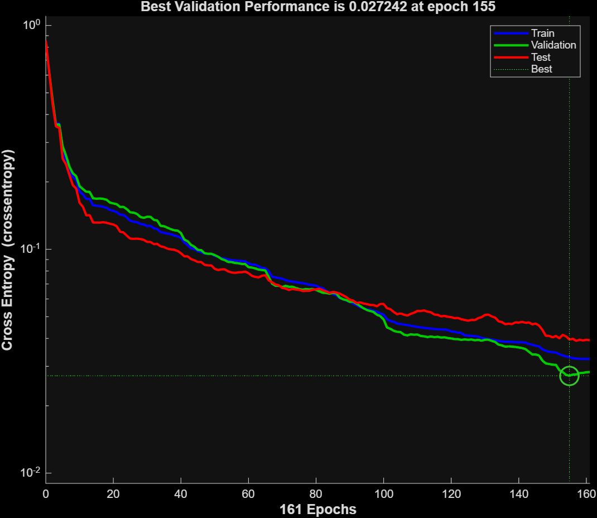
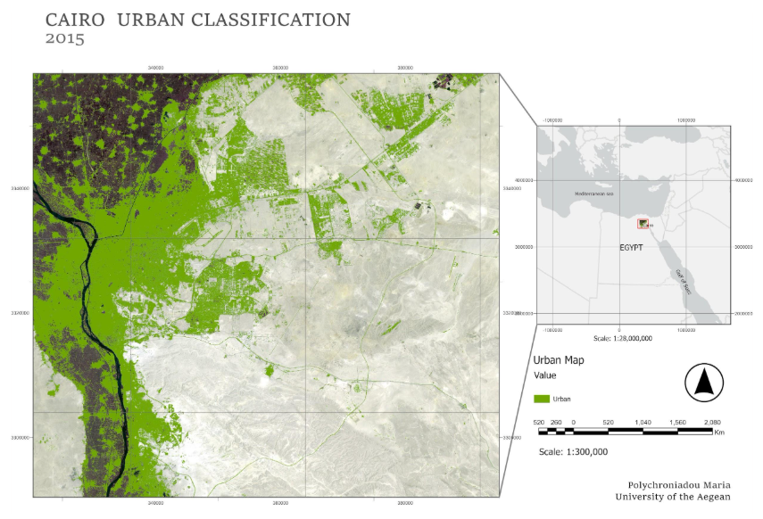
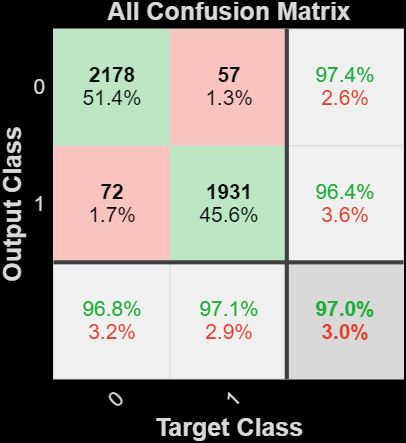
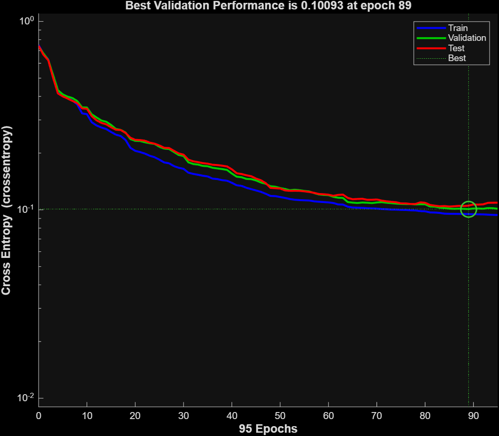
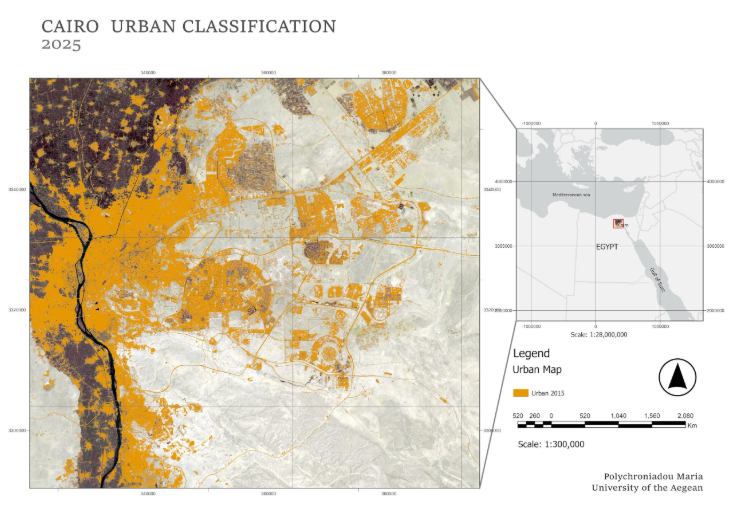

# Binary Classification of Built Environment in Cairo Using MATLAB and GIS

**Author:** Maria M. Polychroniadou  
*University of the Aegean, Department of Geography*

---

## 1. Introduction

This study presents the mapping and decadal binary classification of the built environment across Greater Cairo, Egypt, using an Artificial Neural Network (ANN) trained in MATLAB combined with spatial post-processing in GIS. Monitoring urban sprawl—particularly under rapid demographic growth—is critical for municipal planning, resource management, and environmental monitoring.

Land use and land cover (LULC) classification in arid and semi-arid environments presents distinct challenges, notably spectral confusion between urban materials and surrounding hyper-arid soils. While artificial neural networks effectively model multi-dimensional non-linear spectral signatures, high-resolution scene classification across multi-band satellite rasters can be computationally demanding.

To address computational bottlenecks, the data ingestion and inference pipelines were implemented using **vectorized matrix operations**, eliminating iterative pixel-by-pixel loops and enabling rapid model retraining, hyperparameter optimization, and near-instant full-scene raster classification.

---

## 2. Data and Methodology

### 2.1 Study Area
The study focuses on the metropolitan and peri-urban expanse of Cairo, Egypt. With a population exceeding 23.5 million, Greater Cairo exhibits acute landscape heterogeneity: high-density urban cores sit immediately adjacent to fertile agricultural floodplains along the Nile River corridor and hyper-arid desert plateaus.

  
  

*Sentinel-2 multi-spectral composite acquisitions covering Greater Cairo: 13 August 2015 (left) and 25 August 2025 (right).*

### 2.2 Satellite Data & Geodetic Reference
Multi-spectral surface reflectance imagery was obtained from the European Space Agency (ESA) Copernicus Open Access Hub:
- **Sentinel-2A:** Acquired 13 August 2015
- **Sentinel-2B:** Acquired 25 August 2025

Mid-August acquisitions were selected to ensure cloud-free scenes, consistent seasonal sun angles, and minimal atmospheric interference.
- **Spectral Bands:** 9 channels were retained for classification: B2 (Blue), B3 (Green), B4 (Red), B5, B6, B7 (Red Edge), B8 (NIR), and B11, B12 (SWIR). The 60 m atmospheric bands (B1, B9, B10) and Band 8A were excluded.
- **Coordinate Reference System:** **WGS 84 / UTM zone 36N (EPSG:32636)**.

### 2.3 Methodology
1. **Sampling & Class Definition:** Polygons defining Built-up (Class 1) and Non-built-up (Class 0) areas were digitized in GIS. Ground truth reference polygons were established across stable, persistent land cover classes (core urban fabric, permanent water bodies, active agriculture, and undisturbed desert) to establish consistent, baseline spectral signatures across both the 2015 and 2025 acquisitions.
2. **ANN Architecture:** A pattern recognition network (`patternnet`) was configured in MATLAB to classify spectral vectors into binary outcomes.
3. **Training & Validation:** Training iterations were evaluated using Confusion Matrices, Receiver Operating Characteristic (ROC) curves, and Cross-Entropy loss convergence.
4. **Vectorized Inference & Spatial Post-Processing:** Optimal network weights were applied to the full multi-spectral raster cubes via vectorized matrix multiplication, followed by spatial filtering and change detection analysis.

---

## 3. Results and Discussion

### 3.1 Year 2015 Classification
Training of the 2015 neural network converged at **161 epochs**, achieving its **Best Validation Performance** at epoch 155 with a cross-entropy loss of **0.027242**.

- Hidden Layer Size: 10 neurons
- Architecture: `patternnet(hiddenLayerSize, trainFcn)`
- Data Partition: 70% Training / 20% Validation / 10% Testing

#### Table 1. Training Convergence — 2015 Model
| Metric | Initial Value | Final Value | Target Value |
| :--- | :--- | :--- | :--- |
| **Epoch** | 0 | 161 | 1000 |
| **Cross-Entropy Loss** | 0.852 | 0.0324 | 0 |
| **Gradient** | 0.633 | 0.00498 | 1e-06 |
| **Validation Checks** | 0 | 6 | 6 |

#### Table 2. Classification Accuracy — 2015
The 2015 model achieved an **Overall Accuracy of 99.0%** across the full dataset:
- **Training Accuracy:** 99.1%
- **Validation Accuracy:** 99.0%
- **Test Accuracy:** 98.7% (False Positives: 0.7%, False Negatives: 0.7%)

*Figure 1: Confusion matrices (Training, Validation, Test, All) for the 2015 model.*

  
  

*Figure 2: ROC Curves (left) and Cross-Entropy Loss Convergence (right) for 2015.*

*Figure 3: Built-up environment classification map of Cairo for 2015 (Built-up in green; Scale 1:300,000).*

---

### 3.2 Year 2025 Classification
Training of the 2025 model converged at **95 epochs**, reaching its **Best Validation Performance** at epoch 89 with a cross-entropy loss of **0.10093**.

- Hidden Layer Size: 10 neurons
- Architecture: `patternnet(hiddenLayerSize, trainFcn)`
- Data Partition: 60% Training / 20% Validation / 20% Testing

#### Table 3. Training Convergence — 2025 Model
| Metric | Initial Value | Final Value | Target Value |
| :--- | :--- | :--- | :--- |
| **Epoch** | 0 | 95 | 1000 |
| **Cross-Entropy Loss** | 0.749 | 0.0939 | 0 |
| **Gradient** | 0.559 | 0.0114 | 1e-06 |
| **Validation Checks** | 0 | 6 | 6 |

#### Table 4. Classification Accuracy — 2025
The 2025 model achieved an **Overall Accuracy of 97.0%**:
- **True Positives:** 51.4% (2,178 samples)
- **True Negatives:** 45.6% (1,931 samples)
- **False Positives:** 1.3% (57 samples)
- **False Negatives:** 1.7% (72 samples)
- **Test Set Accuracy:** 97.2%

*Figure 4: Confusion matrices for the 2025 model.*

*Figure 5: Cross-entropy error trajectory across 95 epochs for the 2025 model.*

*Figure 6: Built-up environment classification map of Cairo for 2025 (Built-up in orange; Scale 1:300,000).*

---

### 3.3 Error Analysis & Spectral Limitations
Despite nominal statistical accuracies exceeding 97%, spatial validation identified localized spectral confusion:
1. **High-Albedo Sand vs. Concrete:** Highly reflective limestone desert sand and active excavation sites exhibited spectral reflectance profiles closely resembling concrete and light roof materials.
2. **Mixed Edge Pixels:** 10 m and 20 m pixel footprints at the urban-agricultural boundary contained composite reflectance from irrigated soil and building shadows, leading to boundary uncertainty.
3. **Topographic Hill Shadows:** Steep desert escarpments and dune slopes cast localized shadows that depressed digital numbers into ranges resembling asphalt roads or shaded built structures.

  
  

*Figure 7: Visual inspection of high-albedo sand and dune shadow misclassifications in 2015 (left) and 2025 (right).*

---

## 4. Decadal Urban Change Detection (2015–2025)

### 4.1 Multi-Temporal Change Quantification
Probability rasters were converted to binary masks using an operational probability threshold (Probability >= 0.80 for Built, Probability < 0.80 for Non-built). Decadal change was evaluated via raster difference:

$$\Delta \text{Built} = \text{Built}_{2025} - \text{Built}_{2015}$$

- **Total New Built-Up Pixels:** 5,321,621 pixels
- **Decadal Built Expansion:** **532.16 km²**

The analysis quantifies rapid, massive eastward and peri-urban expansion, prominently delineating developments across New Cairo, the New Administrative Capital axis, and desert plateau corridors.

*Figure 8: Decadal urban expansion footprint of Cairo (2015–2025) showing baseline 2015 built-up area (orange) and 2015–2025 expansion corridors (red; Scale 1:300,000).*

---

## 5. Tools & Environments

- **Satellite Data:** Sentinel-2 Level-2A (ESA Copernicus Open Access Hub)
- **Neural Network Modeling:** MATLAB (Deep Learning / Neural Network Toolbox — `patternnet`)
- **GIS & Spatial Analysis:** ArcGIS Pro / QGIS (Raster Processing, Cartographic Layouts)
- **Spatial Statistics & Plotting:** Python (Data Validation, Change Quantification)

---

## 6. References

1. Yanyan Dong, Xiaogao Chang (2026), Spatio-temporal analysis of land use and land cover changes: assessing urban expansion and ecological transformations (2003–2023), GeoJournal.
2. H. N. Manh, T. V. Anh et al. (2025), Urban Expansion Monitoring Using Sentinel-1 and Sentinel-2 Data Fusion on Google Earth Engine, Volume 2: Earth, Mine, and Environmental Sciences for Green, Sustainable, and Prosperous Development.
3. Osman, T., Arima, T. & Divigalpitiya, P. (2016), Measuring Urban Sprawl Patterns in Greater Cairo Metropolitan Region, J Indian Soc Remote Sens 44, 287–295.
4. European Space Agency (ESA), Cairo Overview and Urban Monitoring. Available: https://www.esa.int/SPECIALS/Eduspace_Global_GR/SEM0G3ZOBFG_2.html

---
*Project developed at the University of the Aegean, Department of Geography.*
